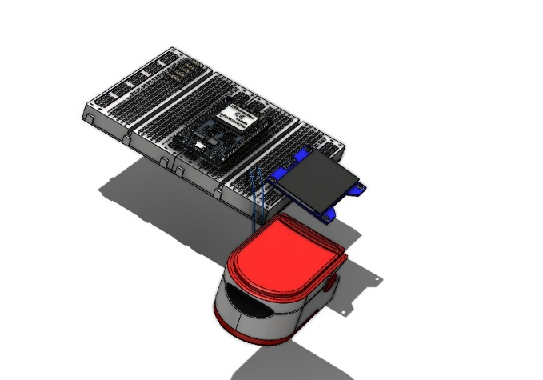

# EcoPulse Recycled PPG Sensor

A heart rate and oxygen sensing prototype that repurposes electronic waste to support hands-on biology and electronics education.

**STEM capstone | Team 10205 | 2025-2026 First semester**

## Egypt grand challenges

Improving the scientific and technological environment, recycling electronic waste, and reducing pollution.

## Prototype

Red and infrared light and a photodetector form a photoplethysmography system, using a finger clip and a housing built around reused components.

## Project materials

| Material | File |
| --- | --- |
| Portfolio | [Research portfolio](portfolio.docx) |
| Poster | [A4 poster](poster-a4.pdf) |
| Prototype design | [Design illustrations and model availability](DESIGN.md) |

## Research context

This repository presents a student team research project. The portfolio contains the project background, design reasoning, methods, and reported findings. Prototype results are reported in their original educational context.

The device is an educational prototype and has not been established as a clinically validated medical device.

## Design and reported results

- Built around an ATmega328P, red and infrared LEDs, and a phototransistor using salvaged components.
- Reported 97.9% accuracy for heart rate and 99% for SpO2 when compared with a commercial oximeter in the project tests.
- Built for under EGP 200, compared with the EGP 500-2,500 commercial range reported in the project summary.
- Final grade: A.

The results and distinctions above are reported in the project portfolio and the application CV.

## Attribution

This project was developed collaboratively by the team credited in the portfolio. This repository is maintained by [Yaseen301](https://github.com/Yaseen301). Team authorship and source references remain in the original documents.

